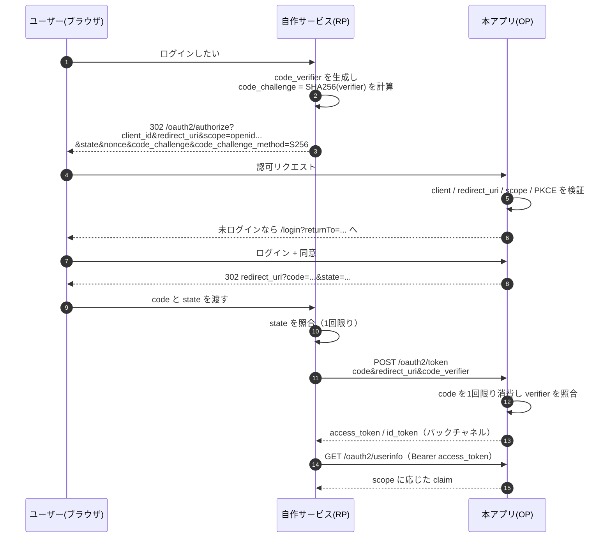

# OAuth 2.0 と OpenID Connect の解説

> 対象: 本リポジトリに関わる開発者・運用者で、「OAuth 2.0 / OIDC とは何か」から確認したい人。
> 位置づけ: **概念の解説**。具体的な接続手順・パラメータ・エンドポイント一覧は
> [`docs/oidc-oauth2-連携ガイド.md`](oidc-oauth2-連携ガイド.md)（RP 実装者・運用者向け）を参照する。
> 正本: `超本格アカウント・認証システム仕様書 v1.3.md` §69。

このドキュメントは「規格の考え方」と「本アプリでの実装」を結びつける。仕様の原文は
RFC 6749（OAuth 2.0）、RFC 7636（PKCE）、OpenID Connect Core 1.0、RFC 9700（OAuth 2.0 セキュリティ
ベストプラクティス）にある。

---

## 1. 一言でいうと

| 規格 | 何を解決するか | 発行するもの |
|---|---|---|
| **OAuth 2.0** | 「利用者の代わりに、他サービスへ**限られた権限を委譲**する」 | access token（権限の委任状） |
| **OpenID Connect（OIDC）** | 「この利用者は**誰か**（本人確認）を、他サービスへ伝える」 | ID Token（身元の証明書） |

OIDC は OAuth 2.0 の**上に載る薄い層**である。OAuth 2.0 の認可コードフローをそのまま使い、
`openid` scope を要求したときだけ ID Token を追加で返す。したがって「OAuth 2.0 をやれば OIDC も
だいたい分かる」が、「OAuth 2.0 は認証の規格ではない」という区別は重要である（§3 の誤解を参照）。

本アプリは**両方の役**を持つ。方向が逆なので混同しないこと。

| 役割 | 誰が | 何をするか | 実装 |
|---|---|---|---|
| **OP / AS**（認証元） | 本アプリ | 自作サービス（RP）へログインを委譲する | `src/lib/oidc/*`（M2.5 / M2.6） |
| **RP / Client**（利用側） | 本アプリ | Google / GitHub / Discord で本アプリへログインする | `src/lib/auth/oauth/*`（Phase 4） |

---

## 2. 登場人物（ロール）

OAuth 2.0 は 4 つのロールを定義する。本アプリを OP として使う場合の対応は次のとおり。

| ロール | 意味 | 本アプリでの実体 |
|---|---|---|
| **Resource Owner** | 権限を持つ人 | エンドユーザー |
| **Client / RP** | 権限を委譲される側 | 自作サービス（`oauth_clients` に登録） |
| **Authorization Server / OP** | 認証してトークンを発行する | 本アプリ（`/oauth2/*`） |
| **Resource Server** | トークンで守られた API | 本アプリの `/oauth2/userinfo`（および RP 側の API） |

> **「Client」は利用者のことではない**。OAuth 2.0 の用語では「委譲を受けるアプリ」を指す。
> 紛らわしいので、本リポジトリでは文脈に応じて「RP」「自作サービス」とも呼ぶ。

---

## 3. よくある誤解

| 誤解 | 実際 |
|---|---|
| 「OAuth でログインできる」 | OAuth 2.0 単体では**認証にならない**。access token は「権限の委任状」であって「身元の証明」ではない。身元確認には OIDC（ID Token）が要る |
| 「access token を検証すれば誰か分かる」 | 分からない。本アプリの access token は**不透明（opaque）なランダム値**で、意味を持つのは `/oauth2/userinfo` に問い合わせたときだけ |
| 「`sub` はユーザー ID」 | 本アプリの `sub` は **client ごとに異なる不透明値**（`sub_...`）。同じ人でも RP が違えば別の `sub` になる（§7.3） |
| 「state を検証すれば十分」 | OIDC では `nonce` の検証も必須。`state` は CSRF 対策、`nonce` は **ID Token のリプレイ**対策で、守る対象が違う |
| 「secret があるから PKCE は不要」 | 本アプリは **confidential でも PKCE `S256` を必須**にしている。多層防御 |

---

## 4. 認可コードフロー（本アプリを OP として使う）

本アプリが対応する唯一のフローは **Authorization Code + PKCE（`S256`）** である
（Implicit / Hybrid / Client Credentials / Device Code / Refresh Token は非対応）。
「認可コード」を一度だけ使える短命の引換券にすることで、トークンを**ブラウザの URL に載せず**、
バックチャネル（サーバー間通信）で受け渡せる。



### 4.1 各ステップの要点

1. **`state`**: RP が生成する推測不能な値。戻ってきた `state` を照合して、フローの取り違え（CSRF）を防ぐ。**1 回限り**消費する。
2. **`nonce`**: OIDC の ID Token に埋め込まれる値。ID Token の**使い回し（リプレイ）**を防ぐ。
3. **PKCE**: 認可リクエスト時に `code_challenge` を送り、トークン交換時に元の `code_verifier` を送る。認可コードを盗んでも verifier が無ければ交換できない。public client（SPA / ネイティブ）で特に重要。
4. **認可コード**: 5 分で失効し、**1 回だけ**交換できる。本アプリは `UPDATE ... WHERE consumed_at IS NULL` の原子消費で 2 回目を必ず失敗させる。
5. **access token**: 600 秒で失効する不透明値。`/oauth2/userinfo` の認証に使う。
6. **ID Token**: RS256 署名された JWT。`iss` / `aud` / `exp` / `nonce` / `sub` を検証して使う。

---

## 5. トークンと claim の中身

### 5.1 ID Token（JWT）の構造

ID Token は `header.payload.signature` の 3 部構成（JWS）である。

```jsonc
// header
{ "alg": "RS256", "kid": "<JWKS と対応する鍵 ID>" }

// payload（claims）
{
  "iss": "https://auth.example.com",   // 発行者 = OIDC_ISSUER
  "aud": "<client_id>",                // 想定受信者
  "sub": "sub_xxxxxxxx",               // client ごとの不透明な利用者識別子
  "exp": 1700000000,                   // 有効期限
  "iat": 1699999700,                   // 発行時刻
  "auth_time": 1699999600,             // 実際に認証した時刻
  "nonce": "<リクエストの nonce>"
}
```

`profile` / `email` scope を要求した場合、`name` / `preferred_username` / `picture` /
`email` / `email_verified` が追加される（本アプリは**確認済みユーザーしかログインさせない**ため
`email_verified` は常に `true`）。

### 5.2 scope と claim の対応

| scope | 得られる claim |
|---|---|
| `openid` | `sub`（必須） |
| `profile` | `name` / `preferred_username` / `picture`（`https:` のときのみ） |
| `email` | `email` / `email_verified` |

本アプリが広告する scope は `openid` / `profile` / `email` の 3 つだけである。`address` / `phone` /
`offline_access` は**広告しない**（未対応）。

### 5.3 署名鍵（JWKS）

ID Token は RS256（RSA 署名）で署名される。検証側（RP）は `/.well-known/openid-configuration` の
`jwks_uri`（= `/oauth2/jwks`）から**公開鍵だけ**を取得し、ID Token ヘッダの `kid` で鍵を選んで検証する。
秘密鍵は OP だけが持つ（本アプリでは `OIDC_JWKS_JSON`）。

---

## 6. 本アプリが RP になる場合（ソーシャルログイン）

Phase 4 の「Google / GitHub / Discord でログイン」は、**本アプリが RP 側**になる。方向が逆なので
実装も別系統（`src/lib/auth/oauth/*`）である。

| provider | プロトコル | 身元の取り方 |
|---|---|---|
| Google | **OIDC** | ID Token を `jose` で検証（`alg` は RS256 固定、`iss` / `aud` / `nonce` を照合）。`profile` も ID Token の claims から取る |
| GitHub | OAuth 2.0 | access token で `/user`・`/user/emails` を叩く。**確認済み email が無ければ新規登録しない** |
| Discord | OAuth 2.0 | access token で `/users/@me` を叩く |

> **OIDC か OAuth 2.0 かの違いが、そのまま「ID Token を検証するか、access token で userinfo を叩くか」の
> 実装差**になる。Google は OIDC なので署名検証だけで身元が確定し、GitHub / Discord は OAuth 2.0 なので
> access token を提示して情報を取りに行く（`src/lib/auth/oauth/types.ts` の `protocol` フィールド）。

この経路は CSRF を `state`（1 回限り消費）+ PKCE で担保する。provider から戻るのは
**top-level GET** なので、`Origin` / `Referer` は検証しない（検証すると必ず 403 になる。BUG-12）。

---

## 7. セキュリティの勘所（なぜそうなっているか）

### 7.1 redirect URI は完全一致

`redirect_uri` は登録値と**完全一致**で照合する。前方一致やワイルドカードを許すと、
攻撃者が細工した URI へ認可コードを送らせる（オープンリダイレクタ経由の窃取）ことができる。
本アプリは `https` 必須（loopback の `http` を除く）、userinfo・fragment を禁止する。

### 7.2 state / nonce は「1 回限り」を DB の更新行数で担保する

「1 回限りの値」を read → 判定 → write の 2 段で消費すると、同時リクエストで二重消費が起きうる。
本アプリは `UPDATE ... WHERE <未消費>` の**更新行数**で消費を判定する（D-16）。
`oauth_states` も認可コードもこの方式である。

### 7.3 `sub` は client ごとに別値（pairwise 相当）

同じユーザーでも RP ごとに `sub` が変わる。これは**RP 間で利用者を横断的に名寄せさせない**ための設計で、
「あるサービスのアカウントと別のサービスのアカウントが同一人物」と判明するのを防ぐ。
本アプリの `subject_types_supported` は `["public"]` だが、`oidc_user_subjects` で client 単位に
不透明値を割り当てているため実質 pairwise に近い（`src/lib/oidc/subjects.ts`）。

### 7.4 client secret はハッシュのみ保存・一度だけ表示

confidential client の secret は生成時に**一度だけ**表示し、DB には HMAC ダイジェストのみ保存する
（`compareClientSecret` をハッシュ比較へ差し替え）。平文は保存しない。

### 7.5 トークンのログ漏洩対策

`code` / `state` / `nonce` / `code_verifier` / `id_token` / `access_token` / `refresh_token` /
`client_secret` は、ログ・`security_events.metadata`・エラーメッセージへ**平文で残さない**
（`src/lib/util/logger.ts` の redaction。§45）。

### 7.6 アカウント状態の再確認

adapter は access token / 認可コード / grant / session を解決するたびに、利用者が
`status='active'` かつ `email_verified=true` かつ `deleted_at IS NULL` かを確認する。
停止・削除されたアカウントの**既発行 token は通らない**。削除時は OIDC grant も破棄する。

---

## 8. 本アプリでの実装マップ

| 関心事 | 実装 |
|---|---|
| Provider 設定（routes / features / TTL / PKCE 必須化） | `src/lib/oidc/provider.ts` |
| PostgreSQL adapter（code / token / interaction の保存・消費） | `src/lib/oidc/adapter.ts` |
| client の検証（redirect URI / scope / web origin） | `src/lib/oidc/client-validation.ts` |
| client の CRUD・secret ローテーション | `src/lib/oidc/clients.ts` |
| client secret のハッシュ化・暗号化 | `src/lib/oidc/crypto.ts` |
| scope allowlist | `src/lib/oidc/scopes.ts` |
| `sub`（client ごとの不透明値） | `src/lib/oidc/subjects.ts` |
| セキュリティイベント | `src/lib/oidc/events.ts` |
| 認可リクエストの事前検証・interaction UI | `scripts/server.ts` |
| RP 側（Google / GitHub / Discord） | `src/lib/auth/oauth/*` |
| 一意性（partial unique index） | `src/lib/db/schema.ts`（`oauth_clients` / `oidc_*`） |

### 8.1 データモデル（抜粋）

| テーブル | 役割 |
|---|---|
| `oauth_clients` | 登録済み RP。`client_id` / 種別 / redirect URI / 許可 scope / web origin / 所有者 |
| `oidc_artifacts` | provider の state（code / token / interaction 等）。暗号化 + HMAC で ID 検索 |
| `oidc_user_grants` | 同意（どのユーザーがどの client に何を許したか） |
| `oidc_user_subjects` | `(user_id, client_id)` → `sub` の対応 |
| `oauth_states` | RP 側（Phase 4）の state / nonce / code_verifier |

---

## 9. 検証

実 HTTP での Discovery → 認可 → 同意 → token → UserInfo → revoke、および PKCE 不一致・
コードリプレイ・誤 secret の拒否は `src/test/e2e/oidc-flow.test.ts`、
Go の `coreos/go-oidc3` との相互運用は `src/test/e2e/oidc-interop-go.test.ts` で検証している（`pnpm test:e2e`）。

---

## 10. 参考リンク

| 規格 | 内容 |
|---|---|
| RFC 6749 | The OAuth 2.0 Authorization Framework |
| RFC 7636 | Proof Key for Code Exchange by OAuth Public Clients（PKCE） |
| RFC 9700 | Best Current Practice for OAuth 2.0 Security |
| OpenID Connect Core 1.0 | 認証層・ID Token・Discovery・UserInfo |
| OpenID Connect Discovery 1.0 | `/.well-known/openid-configuration` |

| 本リポジトリ | 内容 |
|---|---|
| [`docs/oidc-oauth2-連携ガイド.md`](oidc-oauth2-連携ガイド.md) | RP 実装者・運用者向けの接続ガイド（エンドポイント・手順・claim） |
| [`docs/phase2.5-実装計画.md`](phase2.5-実装計画.md) | OP 実装の計画と根拠（P25-*） |
| [`docs/phase2.5-threat-model.md`](phase2.5-threat-model.md) | 脅威モデル |
| [`docs/phase2.5-interop.md`](phase2.5-interop.md) | Go クライアントとの相互運用結果 |
| `超本格アカウント・認証システム仕様書 v1.3.md` §69 | 仕様の正本 |
